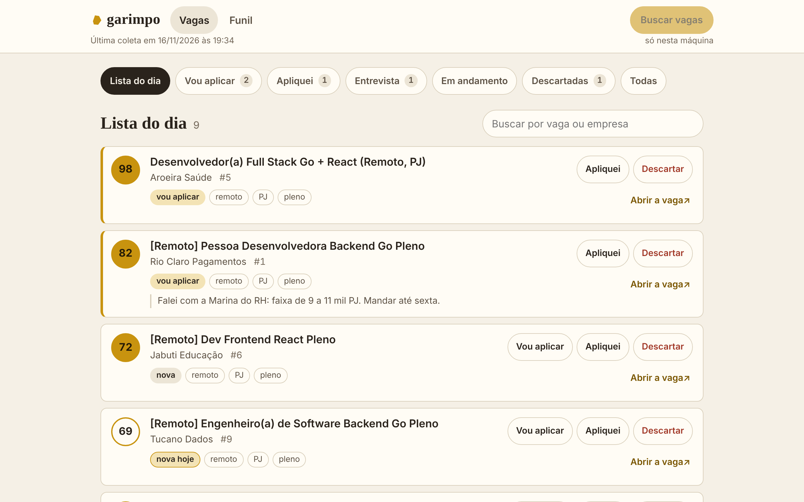
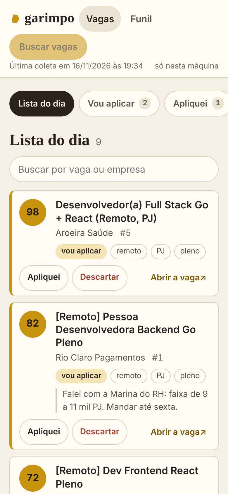
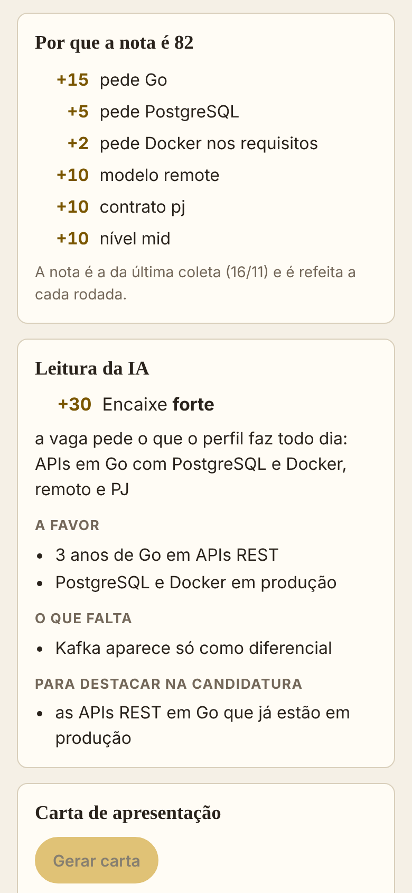
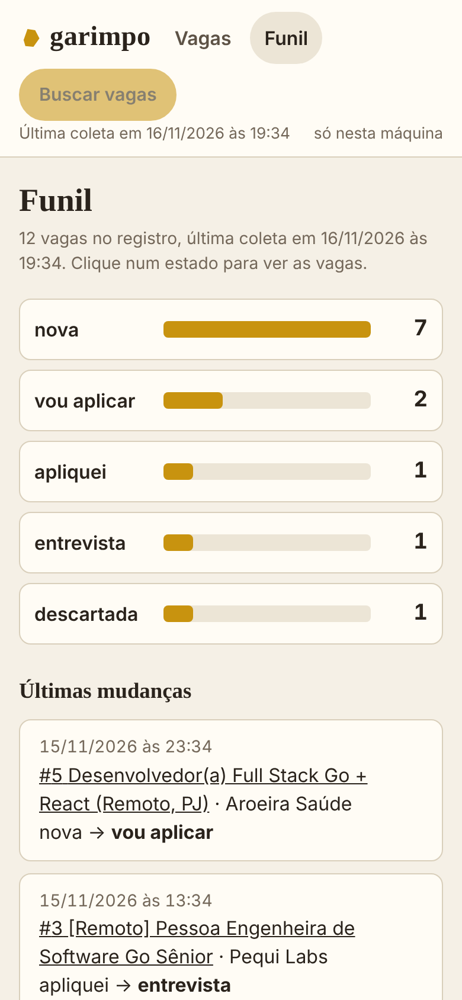
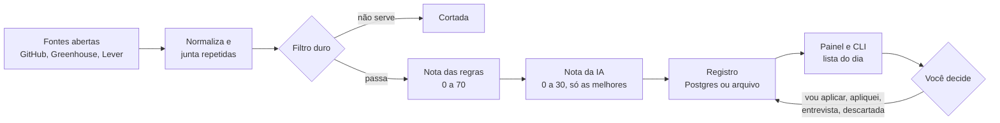

# garimpo

Peneira as vagas de tecnologia do Brasil e fica só com o ouro.

O Garimpo coleta vagas de fontes abertas quando você pede, descarta o que não serve, dá a cada vaga uma nota explicável de 0 a 100 e entrega as melhores num painel que roda na sua máquina. Ele **não** se candidata sozinho: acha, filtra e prepara, e a decisão é sempre sua.



| Lista do dia | Por que a nota é essa | Funil |
| --- | --- | --- |
|  |  |  |

As vagas, as empresas e o perfil das imagens são inventados: vêm do modo demo. A [tela da vaga inteira](docs/img/vaga-desktop.png) e o [funil no desktop](docs/img/funil-desktop.png) também estão em `docs/img/`.

## Ver funcionando

O Garimpo não tem endereço na internet de propósito: o painel mostra a busca de emprego de uma pessoa e roda só na máquina dela ([decisão 041](docs/decisoes/041-o-painel-roda-so-na-maquina-do.md)). Para ver sem configurar nada, o modo demo sobe o mesmo painel com vagas e perfil de exemplo, sem banco e sem rede:

```bash
npm --prefix web ci && npm --prefix web run build   # monta as telas (Node 22.22+ ou 24.15+)
go run ./cmd/garimpo serve -demo                    # abre em http://127.0.0.1:8080
```

Precisa de Go 1.25 ou mais novo. As vagas do demo ficam em [`demo/vagas.json`](demo/vagas.json) e passam pelo filtro e pela nota de verdade, com o [`profile.example.yaml`](profile.example.yaml); só a leitura da IA vem pronta no arquivo. O que você marcar some ao fechar.

## Como funciona



1. **Coleta** de fontes abertas: repositórios de vagas no GitHub e as páginas de vagas de empresas brasileiras no Greenhouse e no Lever. Sem LinkedIn.
2. **Filtro duro**: some o que não serve (presencial, nível errado, setor evitado, duplicada). Nada aqui depende de IA.
3. **Nota**: até 70 pontos calculados em código (stack, remoto, modelo de contrato, nível) e até 30 da IA, comparando a vaga com o currículo. Cada ponto tem um motivo que dá para ler.
4. **Entrega**: o painel mostra a lista do dia e acompanha cada vaga até a entrevista. A vaga só sai da lista quando você marca.

## Stack

- **Go 1.25** na coleta, na nota, na CLI e na API, com a biblioteca padrão sempre que dá: o roteador é o `net/http`.
- **PostgreSQL** no Supabase (plano grátis), em SQL puro com migrações embutidas, pelo driver `pgx`. Sem ORM. Sem banco configurado, tudo fica num arquivo local.
- **React + Vite + TypeScript** no painel, sem biblioteca de rotas, de estado ou de componentes. O build é embutido no binário: um comando sobe tudo.
- **Claude** na nota da IA, pelo `claude -p` da máquina ou pela API, com o SDK oficial.
- **GitHub Actions** na CI: `gofmt`, `go vet`, testes com `-race` (os do banco num Postgres descartável), e lint, testes e build do painel.

## Decisões principais

Cada escolha tem um arquivo em [`docs/decisoes/`](docs/decisoes/), com o contexto e a consequência. As que mais moldaram o projeto:

- **A IA não manda na regra.** O filtro duro roda antes, e a IA só escolhe uma classe (forte, bom, parcial, fraco, nenhum); quem dá os pontos é o código. Um número inventado pelo modelo nunca entra na nota. ([006](docs/decisoes/006-nota-hibrida.md), [019](docs/decisoes/019-a-ia-devolve-uma-classe-forte-bom.md))
- **Nunca se candidata sozinho, e sem LinkedIn.** Só fontes que permitem coleta, e o clique final é de uma pessoa. ([004](docs/decisoes/004-sem-linkedin-e-sem-candidatura-automatica.md))
- **A vaga só sai da lista quando a pessoa marca.** Aparecer numa rodada não conta como vista. ([022](docs/decisoes/022-a-vaga-so-sai-da-lista-quando.md))
- **O painel roda só na máquina.** Escuta em `127.0.0.1`, só atende a própria página, sem login e sem deploy. ([041](docs/decisoes/041-o-painel-roda-so-na-maquina-do.md))
- **Banco fechado por padrão.** As tabelas nascem com RLS ligado e nenhuma policy: a API REST do Supabase não lê nem escreve nada. ([029](docs/decisoes/029-tabelas-com-rls-ligado-e-nenhuma-policy.md))
- **Painel sem biblioteca de rotas, de estado ou de componentes.** São três telas: React, CSS próprio e o `#` do endereço dão conta. ([034](docs/decisoes/034-painel-sem-biblioteca-de-rotas-de-estado.md))
- **O demo passa pela coleta de verdade.** As vagas de exemplo recebem a nota do mesmo código, então o demo não mostra o que o Garimpo não faria. ([044](docs/decisoes/044-o-modo-demo-passa-pela-coleta-de.md))

## Usando com as suas vagas

Copie `profile.example.yaml` para `profile.yaml` (fica fora do git) e ajuste: o que aceitar, o que evitar e quantos pontos vale cada tecnologia.

```bash
go run ./cmd/garimpo serve              # o painel, em http://127.0.0.1:8080
go run ./cmd/garimpo serve -ai local    # liga a IA: nota no "Buscar vagas" e o botão "Gerar carta"
go run ./cmd/garimpo collect -why       # a coleta pelo terminal, com o motivo de cada ponto
```

O passo a passo completo (nota da IA, carta de apresentação, acompanhar as vagas pelo terminal, guardar no banco, API avulsa) está em [docs/USAGE.md](docs/USAGE.md).

```bash
go test -race ./... && go vet ./...     # os testes não usam rede
npm --prefix web run lint && npm --prefix web test
```

## Documentação

- [Como usar](docs/USAGE.md): CLI, painel, banco e API avulsa
- [Arquitetura](docs/ARCHITECTURE.md): o caminho da vaga, as peças e o banco
- [Fluxo da vaga](docs/FLOW.md): os estados do funil e as três telas (CLI, API e painel)
- [Segurança](docs/SECURITY.md): o que protege o painel, o banco e a IA
- [Fontes](docs/SOURCES.md): de onde vêm as vagas e o que os termos de cada uma dizem
- [Decisões](docs/decisoes/): cada escolha e o porquê

## Por que existe

Candidatura em massa costuma render menos entrevista, não mais. O Garimpo aposta no contrário: poucas vagas, bem escolhidas, com o motivo da escolha à vista.

Feito por [Victor Novakoski](https://github.com/Victor-Novakoski).
