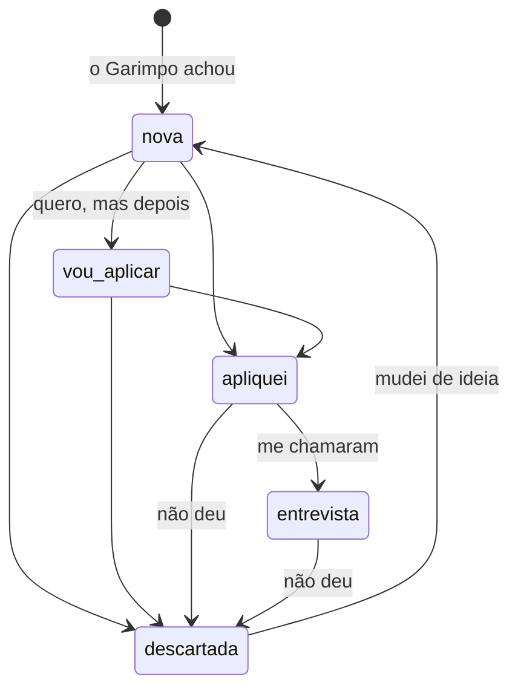
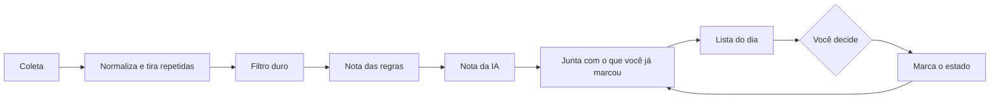

# Fluxo da vaga

Este é o caminho de uma vaga, do momento em que o Garimpo a encontra até você decidir o que fazer com ela. A CLI, a API e o painel seguem este mesmo desenho: muda a tela, não muda a regra.

## A ideia central

O Garimpo não adivinha o que você fez. Uma vaga só sai da sua lista quando **você** marca. Aparecer numa rodada não conta como vista.

## Os estados

| Estado | No código | O que significa | Aparece na lista do dia? |
| --- | --- | --- | --- |
| nova | `new` | o Garimpo achou e você ainda não decidiu | sim |
| vou aplicar | `saved` | você quer, mas ainda não se candidatou | sim, no topo |
| apliquei | `applied` | candidatura enviada | não, fica na lista de acompanhamento |
| entrevista | `interview` | a empresa respondeu | não, fica na lista de acompanhamento |
| descartada | `discarded` | não interessa, ou não deu certo | não |

Qualquer estado pode ser trocado por qualquer outro: marcar errado acontece. O diagrama mostra o caminho comum, não uma trava. Cada troca fica registrada com data, para dar o histórico ("apliquei dia 12, me chamaram dia 20").

Cada vaga também pode ter uma **anotação** livre (com quem falou, faixa salarial, link do processo).

## O que o sistema marca sozinho

Duas coisas não dependem de você e não são estados:

- **Nova hoje**: a vaga apareceu pela primeira vez nesta rodada. É só uma etiqueta para você ver o que mudou; a vaga continua "nova" amanhã se você não marcar.
- **Saiu da fonte**: a vaga não veio mais na coleta (a empresa fechou a posição, ou a issue ficou velha). Ela deixa de aparecer na lista do dia e fica com esse aviso no `garimpo list`. Se você já aplicou, continua no seu acompanhamento. O aviso só é dado quando a fonte respondeu: fonte fora do ar não apaga vaga.

## A rodada

Os passos de A a E já existem. O passo F é o que este documento acrescenta: antes de mostrar, o Garimpo cruza as vagas da rodada com o registro do que você já marcou.

A lista do dia mostra, nesta ordem:

1. as que você marcou como **vou aplicar**;
2. as **novas**, por nota, com a etiqueta "nova hoje" nas que chegaram nesta rodada.

## Regras que não mudam

- **A identidade da vaga é a fonte mais o id na fonte** (`job.Key`). O título pode mudar e a vaga continua a mesma, com o mesmo estado.
- **Cada vaga tem um número curto** (`#12`), dado na primeira vez que aparece e que nunca muda. É o que você usa para marcar.
- **Vaga repetida em duas fontes é uma vaga só.** O estado vale para todas as cópias.
- **A nota não é guardada como verdade.** Ela é recalculada a cada rodada, porque o perfil e as regras mudam. O estado, as datas e a anotação são o que fica guardado.
- **Mudar o perfil não apaga nada.** Se uma vaga em que você aplicou passa a ser cortada pelo filtro, ela continua no seu acompanhamento.
- **Nada disso candidata você.** Marcar "apliquei" é você contando que se candidatou.

## As três telas do mesmo fluxo

| | CLI | API | Painel (`garimpo serve`) |
| --- | --- | --- | --- |
| Coletar | `garimpo collect` | `POST /collect` (só no painel local) | botão "Buscar vagas" |
| Ver a lista do dia | `garimpo collect` | `GET /jobs` | tela inicial, "Lista do dia" |
| Ver o que está em andamento | `garimpo list` | `GET /jobs?status=interview,applied,saved` | filtro "Em andamento" |
| Ver um estado | `garimpo list apliquei` | `GET /jobs?status=applied` | filtros por estado, e o funil |
| Ver uma vaga | `garimpo show 12` | `GET /jobs/12` | tela da vaga, com os motivos da nota e a leitura da IA |
| Marcar | `garimpo mark 12 apliquei` | `PATCH /jobs/12` | botões na lista (com desfazer) e na vaga |
| Anotar | `garimpo note 12 "falei com a Ana"` | `PATCH /jobs/12` | campo na vaga |
| Ver o funil | `garimpo list tudo` | `GET /funnel` | tela "Funil": contagem por estado e últimas mudanças |
| Onde fica guardado | arquivo na pasta de configuração do usuário (`garimpo/vagas.json`), fora do git, ou o Postgres | o mesmo registro da CLI | o mesmo registro, pela API |

No código, quem guarda e lê os estados fica atrás de uma interface (`tracker.Store`), do mesmo jeito que a IA fica atrás de `ai.Scorer`. Há duas implementações, o arquivo e o Postgres, com as mesmas regras e os mesmos testes; a CLI e a API usam o banco quando `GARIMPO_DATABASE_URL` está definida e o arquivo quando não está. O `garimpo import` copia o arquivo local para o banco, para você não perder o que já marcou.

Na API, `GET /jobs` sem parâmetro é a lista do dia (sem o que saiu da fonte); com `?status=` vêm todas as vagas daqueles estados, e as que saíram da fonte trazem `"gone": true`. "Nova hoje" (`new_today`) é a vaga vista pela primeira vez na última rodada. O `PATCH` aceita `status`, `note` ou os dois, e uma anotação vazia apaga a anterior.

## Ordem de construção

1. **Registro local e comandos** (`mark`, `list`, `show`, `note`), com a lista do dia já cruzada com os estados.
2. **Mais fontes**, para a lista ter mais vagas.
3. **Banco e API** (etapa 3), com os mesmos estados e a importação do arquivo local.
4. **Painel** (etapa 4), que só chama a API e roda na máquina, pelo `garimpo serve`.
5. **Job diário e Telegram**, que passam a avisar só do que é "nova hoje".
